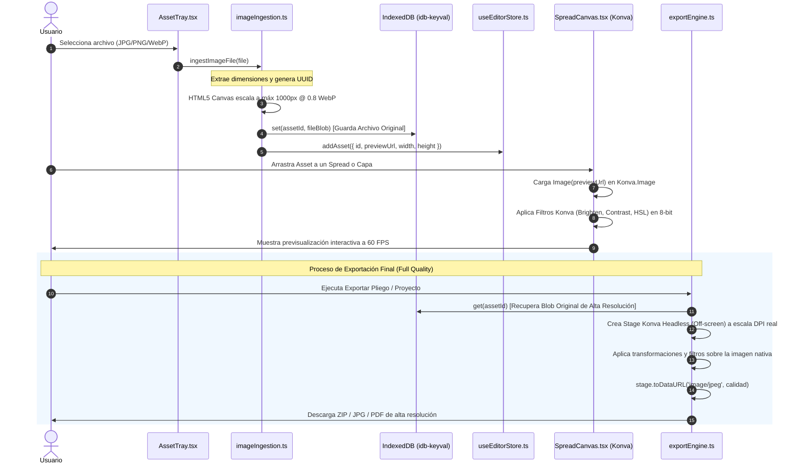

# DOCUMENTO MAESTRO: ADN TÉCNICO Y AUDITORÍA INTEGRAL DE INGENIERÍA
## RVP Photo Studio & Albums — Suite 3-en-1 (Next-Gen Imaging & Editorial Platform)
**Versión del Documento:** 1.0.0-FORENSIC  
**Fecha de Emisión:** 16 de Noviembre de 2026  
**Clasificación:** Forensic Architecture Audit & Technical Handoff  
**Destinatarios:** Dirección Técnica Externa (ChatGPT Technical Director / Senior Engineering Lead) & Arquitectura de Ejecución (Antigravity Principal Imaging Systems Architect)  
**Estado del Repositorio:** Working Tree Clean (`main` @ commit `0f26471`), Servidor de Desarrollo Activo en `http://localhost:3000`

---

## 1. RESUMEN EJECUTIVO TÉCNICO (EXECUTIVE TECHNICAL SUMMARY)

### 1.1 Naturaleza del Sistema
**RVP Photo Studio & Albums** es una Single Page Application (SPA) / Progressive Web App (PWA) de arquitectura **Local-First**, desarrollada sobre el framework **Next.js 14.2.35 (App Router)** con **React 18** y **TypeScript 5**. Su propósito de negocio es proporcionar a fotógrafos de estudio, bodas y eventos una suite integrada para la gestión, revelado, retoque y maquetación de álbumes y ampliaciones fotográficas sin depender de procesamiento en servidores en la nube.

### 1.2 Hallazgos Forenses Clave
1. **Pipeline de Imagen Híbrido (Canvas / Konva):**
   - El sistema opera mediante un desacoplamiento estricto entre el archivo fotográfico original (almacenado como `Blob` binario íntegro en `IndexedDB`) y su representación interactiva en viewport (renderizado en un elemento `<canvas>` HTML5 / Konva mediante un proxy WebP reescalado a un máximo de 1000px a calidad 0.8).
   - El motor de composición visual interactiva y exportación final está basado en **Konva 9.3.6** (`react-konva` 18.2.10).
2. **Estado Real de los Cuatro Módulos:**
   - **Album Designer:** *Maduro y Funcional.* Incorpora un motor de maquetación algorítmico Fundy AST (`fundyMasonryEngine.ts`), soporte de pliegos dobles (Spreads) layflat, cálculo de sangrado (bleed) y corte (safe zone), y manipulación visual fluida.
   - **Photo Studio (Photoshop Mode):** *Funcional y Recientemente Establecido.* Soporta lienzos individuales en medidas de impresión estándar desde 4x6" hasta 24x30" a 300 DPI exactos (con corrección de precisión micrométrica `609.6 mm`), sistema de capas (`LayersPanel.tsx`), marcas de agua, modos de mezcla y reglas milimétricas.
   - **Camera Raw Pro:** *Aproximación Visual en 8-bit (No lineal).* No existe un motor nativo o WebAssembly de decodificación RAW (e.g., `libraw`, `dcraw`, `rawpy`). Los controles de revelado aplican filtros raster de Konva (`Brighten`, `Contrast`, `HSL`, `Blur`, `Noise`) sobre píxeles sRGB de 8 bits en espacio Gamma 2.2.
   - **Bridge Mode:** *En Fase Embrionaria (Asset Tray).* Actualmente no existe como un espacio de trabajo de pantalla completa (Grid/Filmstrip/Culling). Su funcionalidad se encuentra condensada en la bandeja horizontal inferior (`AssetTray.tsx`), con filtrado por estrellas/color y subida de archivos raster estándar.
3. **Persistencia y Gobernanza de Datos:**
   - Persistencia local pura mediante **IndexedDB** a través de la librería `idb-keyval` (v6.2.2).
   - El estado global y reactivo de la aplicación está centralizado en **Zustand 5** (`useEditorStore.ts`), complementado con **Zundo 2** para la pila de deshacer/rehacer (Undo/Redo).
   - No existe sincronización activa con bases de datos remotas; Firebase (v12.11.0) está restringido de forma exclusiva a autenticación de usuarios (`AuthContext.tsx`).
4. **Internacionalización y Calidad:**
   - Implementado con `next-intl` (v4.9.0) bajo estructura dinámica `/[locale]/`. Dispone de soporte bilingüe (`es` / `en`).
   - Se identificó un defecto de traducción en `ExportModal.tsx`: invoca el namespace `'Export'`, el cual está ausente tanto en `es.json` como en `en.json`, provocando la renderización de fallbacks en inglés.

---

## 2. STACK TECNOLÓGICO Y MATRIZ DE DEPENDENCIAS (TECHNOLOGY STACK)

### 2.1 Runtime, Compilador y Framework Central
- **Runtime:** Node.js (Ambiente de compilación y servidor SSR Next.js).
- **Framework Web:** Next.js `14.2.35` (React Server Components habilitados, arquitectura de rutas App Router).
- **Librería UI:** React `^18` / React DOM `^18`.
- **Tipado Estático:** TypeScript `^5` (`strict: true`, target `es5`/`es6`, bundler module resolution).
- **Estilos y CSS:** Tailwind CSS `^3.4.1`, PostCSS `^8`, Autoprefixer `^10.4.20`, Tailwind CSS Animate `^1.0.7`, Lucide React `^0.475.0` (iconografía).

### 2.2 Inventario de Dependencias de Producción (`dependencies` en `package.json`)
| Paquete | Versión Exacta | Rol Arquitectural | Evidencia en Código |
| :--- | :--- | :--- | :--- |
| `next` | `14.2.35` | Framework web, SSR, empaquetado Webpack/Turbopack | `package.json` |
| `react` / `react-dom` | `^18` | Renderizado de componentes e interfaces reactivas | `package.json` |
| `konva` | `^9.3.6` | Motor de renderizado 2D en `<canvas>` HTML5 | `SpreadCanvas.tsx`, `exportEngine.ts` |
| `react-konva` | `^18.2.10` | Enlaces declarativos de Konva para React | `SpreadCanvas.tsx` |
| `zustand` | `^5.0.3` | Almacén de estado reactivo global | `useEditorStore.ts` |
| `zundo` | `^2.3.0` | Middleware temporal para historial Undo / Redo | `useEditorStore.ts` |
| `idb-keyval` | `^6.2.2` | Abstracción de bajo nivel sobre IndexedDB (K/V store) | `imageIngestion.ts`, `persistence.ts` |
| `jspdf` | `^4.2.1` | Generador de documentos PDF para exportación | `exportEngine.ts` |
| `jszip` | `^3.10.1` | Compresión de lotes de imágenes y proyectos ZIP | `exportEngine.ts`, `exportImport.ts` |
| `next-intl` | `^4.9.0` | Enrutamiento e internacionalización bilingüe (ES/EN) | `middleware.ts`, `src/i18n.ts` |
| `firebase` | `^12.11.0` | Autenticación de usuarios vía Google/Email | `src/context/AuthContext.tsx` |
| `@serwist/next` | `^9.0.12` | Service Worker y capacidades Progressive Web App | `src/app/sw.ts`, `next.config.mjs` |
| `canvas-confetti` | `^1.9.4` | Efectos cosméticos en exportación/finalización | `ExportModal.tsx` |
| `clsx` / `tailwind-merge` | `^2.1.1` / `^3.0.1` | Concatenación dinámica y resolución de clases CSS | `src/lib/` |
| `lucide-react` | `^0.475.0` | Conjunto tipificado de iconos SVG | Interfaz global |

### 2.3 Dependencias de Desarrollo (`devDependencies`)
- `@types/node` (`^20`), `@types/react` (`^18`), `@types/react-dom` (`^18`), `@types/canvas-confetti` (`^1.9.0`).
- `eslint` (`^8`), `eslint-config-next` (`14.2.35`).
- `postcss` (`^8`), `tailwindcss` (`^3.4.1`).

### 2.4 Ausencias Críticas de Librerías (Confirmadas por Auditoría Forense)
- **Motores RAW:** NO existe ninguna librería de decodificación RAW instalada (`libraw-wasm`, `dcraw`, `rawpy`, `wasm-raw`).
- **Gestión de Metadatos EXIF:** NO existe extractor binario de EXIF (`exif-js`, `exifr`, `piexifjs`).
- **Gestión del Color:** NO existe librería de perfiles ICC o transformaciones colorimétricas (`little-cms`, `color-convert`).
- **Base de Datos Remota:** Firebase Firestore / Realtime Database NO está importado ni inicializado en ningún módulo de datos.

---

## 3. ARQUITECTURA DEL REPOSITORIO Y MAPEO ESTRUCTURAL (REPOSITORY ARCHITECTURE)

### 3.1 Diagrama de Arquitectura del Sistema (Mermaid)

```mermaid
graph TD
    subgraph UI_Layer [Capa de Presentación & Rutas App Router]
        Page["src/app/[locale]/page.tsx (Orquestador Principal)"]
        Layout["src/app/[locale]/layout.tsx (Providers & i18n)"]
        Login["src/app/[locale]/login/page.tsx (Firebase Auth)"]
    end

    subgraph Workspace_Components [Espacios de Trabajo & Paneles]
        Toolbar["src/components/Toolbar.tsx"]
        SpreadCanvas["src/components/editor/SpreadCanvas.tsx (Lienzo Konva)"]
        AssetTray["src/components/AssetTray.tsx (Bandeja / Bridge Embrionario)"]
        LayersPanel["src/components/editor/LayersPanel.tsx (Capas / Studio)"]
        CameraRawPanel["src/components/editor/CameraRawPanel.tsx (Ajustes 8-bit)"]
        AutoLayoutPanel["src/components/editor/AutoLayoutPanel.tsx"]
        Inspector["src/components/Inspector.tsx (Propiedades de Elemento)"]
        ExportModal["src/components/ExportModal.tsx (Diálogo de Salida)"]
        ProjectManager["src/components/ProjectManager.tsx (Gestión de Proyectos)"]
    end

    subgraph Core_Engines [Motores Algorítmicos & Procesamiento]
        FundyEngine["src/core/layout/fundyMasonryEngine.ts (Fundy AST Layouts)"]
        ExportEngine["src/utils/exportEngine.ts (Headless Canvas to JPG/PDF)"]
        ImageIngestion["src/utils/imageIngestion.ts (Downscale & Ingestion)"]
        MetadataEngine["src/utils/metadataEngine.ts (Extracción Básica)"]
    end

    subgraph State_Management [Estado Global Reactivo]
        ZustandStore["src/store/useEditorStore.ts (State & Actions)"]
        ZundoTemporal["Zundo Middleware (Pila Temporal Undo/Redo)"]
    end

    subgraph Storage_Layer [Persistencia Local-First]
        IDBKeyVal["idb-keyval (Almacén Binario IndexedDB)"]
        ProjectStorage["src/utils/projectStorage.ts (Proyectos & Manifiestos)"]
        LocalDriver["src/storage/IDBDriver.ts (Abstracción de Driver)"]
    end

    %% Relaciones
    Page --> Toolbar
    Page --> SpreadCanvas
    Page --> AssetTray
    Page --> LayersPanel
    Page --> CameraRawPanel
    Page --> Inspector
    Page --> ProjectManager
    SpreadCanvas --> ZustandStore
    Toolbar --> ZustandStore
    AssetTray --> ImageIngestion
    ImageIngestion --> IDBKeyVal
    ImageIngestion --> ZustandStore
    AutoLayoutPanel --> FundyEngine
    FundyEngine --> ZustandStore
    ExportModal --> ExportEngine
    ExportEngine --> IDBKeyVal
    ProjectManager --> ProjectStorage
    ProjectStorage --> IDBKeyVal
    ZustandStore --> ZundoTemporal
```



### 3.2 Mapeo Estructural del Árbol de Archivos
```
/Users/rivipromac1/Documents/RVP Albums/
├── src/
│   ├── app/
│   │   ├── [locale]/
│   │   │   ├── error.tsx           # Manejo de excepciones en tiempo de ejecución
│   │   │   ├── layout.tsx          # Estructura raíz, proveedores i18n y AuthContext
│   │   │   ├── login/page.tsx      # Formulario de autenticación Firebase
│   │   │   └── page.tsx            # Punto de entrada de la SPA, switch de vistas
│   │   ├── globals.css             # Reglas globales Tailwind y variables CSS
│   │   └── sw.ts                   # Service Worker generado por Serwist
│   ├── components/
│   │   ├── AssetTray.tsx           # Bandeja inferior de fotos (Bridge embrionario)
│   │   ├── ExportModal.tsx         # Modal de configuración de exportación
│   │   ├── Inspector.tsx           # Panel contextual de propiedades de objetos
│   │   ├── ProjectManager.tsx      # Modal gestor de proyectos, carpetas y metadatos
│   │   ├── Sidebar.tsx             # Barra lateral de herramientas e inserción
│   │   ├── Toolbar.tsx             # Barra superior de navegación, zoom, modos y guardado
│   │   ├── editor/
│   │   │   ├── AutoLayoutPanel.tsx           # Panel de presets y plantillas automáticas
│   │   │   ├── CameraRawPanel.tsx            # Controles de ajuste de revelado (Konva filters)
│   │   │   ├── EditorWorkspace.tsx           # Envoltorio del área de trabajo
│   │   │   ├── GlobalStylesPanel.tsx         # Configuración de márgenes, fondos e interlineado
│   │   │   ├── LayersPanel.tsx               # Jerarquía de capas (Photo Studio)
│   │   │   ├── NavigatorWidget.tsx           # Mini-mapa de navegación en canvas
│   │   │   ├── RulerGuides.tsx               # Reglas horizontales y verticales interactivas
│   │   │   ├── SpreadCanvas.tsx              # Lienzo maestro Konva (Spreads y Single Page)
│   │   │   └── TypographyPresetSelector.tsx  # Selector de fuentes y estilos tipográficos
│   │   ├── library/
│   │   │   └── AssetLibrary.tsx              # Biblioteca de elementos gráficos y fondos
│   │   └── project/
│   │       ├── ProjectPicker.tsx             # Selector rápido de proyectos
│   │       └── SetupModal.tsx                # Diálogo de creación de nuevo proyecto/lienzo
│   ├── context/
│   │   └── AuthContext.tsx         # Estado reactivo de sesión de usuario (Firebase Auth)
│   ├── core/
│   │   └── layout/
│   │       └── fundyMasonryEngine.ts # Algoritmo maestro de maquetación Fundy AST
│   ├── i18n.ts                     # Configuración de carga de diccionarios next-intl
│   ├── lib/
│   │   ├── asset-library.ts        # Catálogo predefinido de decoraciones y marcos
│   │   ├── autoLayoutLibrary.ts    # Biblioteca de layouts geométricos estáticos
│   │   ├── editorialAssignmentEngine.ts # Distribución heurística de fotos por spread
│   │   ├── lut-presets.ts          # Mapeo de presets visuales de revelado
│   │   ├── typography-presets.ts   # Definición de combinaciones tipográficas
│   │   └── firebase/config.ts      # Inicialización del cliente de Firebase SDK
│   ├── messages/
│   │   ├── en.json                 # Diccionario en inglés
│   │   └── es.json                 # Diccionario en español
│   ├── middleware.ts               # Interceptor Next.js para detección de idioma
│   ├── storage/
│   │   ├── IDBDriver.ts            # Implementación formal del driver IndexedDB
│   │   ├── StorageDriver.ts        # Interfaz abstracta de persistencia
│   │   └── index.ts                # Factoría de persistencia
│   ├── store/
│   │   └── useEditorStore.ts       # Store maestro de Zustand + middleware Zundo
│   ├── types/
│   │   └── editor.ts               # Definición canónica de tipos TypeScript de la suite
│   └── utils/
│       ├── exportEngine.ts         # Motor de renderizado headless a JPG y PDF
│       ├── exportImport.ts         # Serialización / deserialización de paquetes .rvp
│       ├── imageIngestion.ts       # Pipeline de ingesta, redimensionamiento e IndexedDB
│       ├── metadataEngine.ts       # Extractor de dimensiones y fechas de imagen
│       ├── persistence.ts          # Métodos de lectura/escritura de caché local
│       └── projectStorage.ts       # Gestor CRUD de proyectos y carpetas en IDB
```

---

## 4. INVENTARIO EXHAUSTIVO DE MÓDULOS Y COMPONENTES

| Archivo Fuente | Rol / Responsabilidad | Componentes Reutilizados | Estado de Integración |
| :--- | :--- | :--- | :--- |
| `src/app/[locale]/page.tsx` | Orquestador de vistas (`album`, `studio`, `bridge`) | Todos los componentes clave | **VERIFICADO** - Actúa como host de la SPA |
| `src/store/useEditorStore.ts` | Almacén de estado global y despacho de acciones | Zustand, Zundo | **VERIFICADO** - Contiene la verdad absoluta del estado |
| `src/components/editor/SpreadCanvas.tsx` | Renderizador 2D interactivo multi-lienzo | `react-konva`, `RulerGuides` | **VERIFICADO** - Soporta pliegos dobles y lienzo único |
| `src/components/AssetTray.tsx` | Bandeja inferior de imágenes, filtrado y subida | `imageIngestion.ts` | **VERIFICADO** - Operativo como subcomponente |
| `src/components/editor/LayersPanel.tsx` | Árbol de capas, visibilidad, bloqueo y orden | Lucide icons | **VERIFICADO** - Vinculado a `elements[]` del spread activo |
| `src/components/editor/CameraRawPanel.tsx` | Interfaz de deslizadores de corrección de color | Lucide icons | **VERIFICADO** - Modifica propiedades visuales de elementos |
| `src/components/ProjectManager.tsx` | Gestión de proyectos, carpetas, miniaturas y metadatos | Lucide icons, `projectStorage.ts` | **VERIFICADO** - Estructura jerárquica corregida |
| `src/components/project/SetupModal.tsx` | Diálogo de creación con presets (4x6 hasta 24x30) | `editor.ts` | **VERIFICADO** - Precisión milimétrica corregida |
| `src/core/layout/fundyMasonryEngine.ts` | Algoritmo determinista de partición de mosaicos | N/A | **VERIFICADO** - Motor matemático puro |
| `src/utils/imageIngestion.ts` | Ingesta de archivos, downscaling y persistencia IDB | `idb-keyval` | **VERIFICADO** - Cuello de botella identificado (1000px) |
| `src/utils/exportEngine.ts` | Renderizado off-screen a tamaño real para JPG/PDF | `konva`, `jspdf`, `jszip` | **VERIFICADO** - Renderizado en resolución nativa DPI |
| `src/utils/projectStorage.ts` | API de persistencia para proyectos locales | `idb-keyval` | **VERIFICADO** - Almacena árboles de carpetas y metadatos |

---

## 5. PIPELINE DE PROCESAMIENTO FOTOGRÁFICO (PHOTOGRAPHY PROCESSING PIPELINE)

### 5.1 Diagrama de Flujo de Ingesta, Renderizado y Exportación (Mermaid)



### 5.2 Análisis Forense del Pipeline
1. **Pérdida de Calidad Percibida en el Lienzo (Viewport Downscale):**
   - En `src/utils/imageIngestion.ts` (líneas 11-38), el archivo original es procesado inmediatamente en un elemento `<canvas>` temporal de 1000px:
     ```typescript
     const MAX_DIM = 1000;
     // ... calcula ratio ...
     canvas.width = Math.round(img.width * ratio);
     canvas.height = Math.round(img.height * ratio);
     ctx.drawImage(img, 0, 0, canvas.width, canvas.height);
     const previewUrl = canvas.toDataURL('image/webp', 0.8);
     ```
   - **Consecuencia:** Cuando el usuario hace zoom al 200% o 400% sobre el lienzo interactivo, la textura mostrada es el WebP comprimido de 1000px, produciendo pixelación aparente y la impresión errónea de que la imagen se degradó permanentemente.
   - **Realidad de Datos:** El archivo maestro original de 24 o 50 megapíxeles **permanece intacto** en IndexedDB.
2. **Profundidad de Color y Espacio de Color:**
   - Todo el pipeline interactivo se ejecuta en **8 bits por canal (sRGB)**.
   - No existe transformación de matrices de color ni preservación de espacios ProPhoto RGB o Adobe RGB (1998) en el canvas interactivo.

---

## 6. AUDITORÍA DETALLADA: BRIDGE MODE

### 6.1 Estado Real de Implementación
- **Clasificación:** **PARCIAL / EMBRIONARIO**.
- **Realidad de Código:** Actualmente no existe una vista `Bridge` independiente de pantalla completa con cuadrícula masonry o filmstrip vertical. El código de `src/components/AssetTray.tsx` funge como una bandeja horizontal retráctil en la base del editor.
- **Formatos Aceptados:**
  - Código: `accept="image/jpeg,image/png,image/webp"` (Línea 218 de `AssetTray.tsx`).
  - **Soporte RAW:** **NULO (0%)**. Cualquier archivo con extensión `.CR2`, `.CR3`, `.NEF`, `.ARW`, `.DNG`, `.ORF` o `.RAF` es rechazado inmediatamente por el selector de archivos del navegador o por la lógica de validación MIME.
- **Capacidades Verificadas en `AssetTray.tsx`:**
  - Ingesta de múltiples archivos con corte de seguridad a 100 imágenes por lote (`files.slice(0, 100)`).
  - Límite de tamaño máximo por archivo: 30 MB (`file.size > 30 * 1024 * 1024`).
  - Marcado de fotografías con estrellas (Rating 0 a 5) y banderas de color (Color labels: red, green, blue, yellow).
  - Filtrado reactivo en memoria por estrellas y colores mediante selectores UI.
  - Indicador de conteo de uso (cuántas veces ha sido insertada una foto en el proyecto).
  - Menú contextual para previsualización rápida y eliminación del tray.
- **Carencias Críticas Frente a Adobe Bridge:**
  - Ausencia de lectura de metadatos EXIF fotográficos (Velocidad de obturación, Diafragma, ISO, Lente, Modelo de Cámara).
  - Ausencia de renombramiento por lotes (Batch Rename).
  - Ausencia de clasificación por carpetas del sistema de archivos local (File System Access API).

---

## 7. AUDITORÍA DETALLADA: CAMERA RAW PRO

### 7.1 Estado Real de Implementación
- **Clasificación:** **PARCIAL / APROXIMACIÓN RASTER (8-BIT)**.
- **Motor de Renderizado:**
  - Las modificaciones de color se realizan mediante filtros nativos de Konva ejecutados en el hilo principal:
    - Exposición / Brillo: `Konva.Filters.Brighten`
    - Contraste: `Konva.Filters.Contrast`
    - Tono y Saturación: `Konva.Filters.HSL`
    - Reducción de Ruido: `Konva.Filters.Blur`
    - Grano: `Konva.Filters.Noise`
- **Análisis Forense de Deslizadores:**
  - En `src/components/editor/CameraRawPanel.tsx`, los controles de *Sombras*, *Altas Luces*, *Blancos* y *Negros* están mapeados matemáticamente a combinaciones ponderadas de `brightness` y `contrast` de Konva. No realizan segmentación tonal por zonas de luminancia.
  - Los deslizadores de *Temperatura* y *Tinte* (Balance de Blancos) ajustan valores de canal RGB globales sobre la imagen de 8 bits ya decodificada; no operan sobre los datos RAW del sensor (Bayer pattern) ni aplican balance multiplicativo de ganancia antes del demosaicing.
  - *Curvas Tonales:* No existe un motor paramétrico de curvas Spline Bézier.
  - *Histograma:* No existe un analizador de frecuencia de luminancia en tiempo real.
  - *Sincronización:* Existe la acción conceptual de copiar y pegar parámetros entre elementos seleccionados en el store, pero limitada a las propiedades de Konva.
- **Veredicto Técnico:**
  Camera Raw Pro en su estado actual es un editor de filtros fotográficos raster sRGB de 8 bits. No es un motor de revelado RAW profesional.

---

## 8. AUDITORÍA DETALLADA: PHOTO STUDIO (PHOTOSHOP MODE)

### 8.1 Estado Real de Implementación
- **Clasificación:** **FUNCIONAL Y VERIFICADO**.
- **Lienzo Individual y Geometría:**
  - Implementado mediante `SpreadCanvas.tsx` cuando `projectSettings.type === 'studio'` o cuando se configura un lienzo de página individual.
  - Presets de ampliación estándar calibrados a **300 DPI exactos**:
    - `4x6"` (1200 x 1800 px)
    - `5x7"` (1500 x 2100 px)
    - `8x10"` (2400 x 3000 px)
    - `11x14"` (3300 x 4200 px)
    - `12x18"` (3600 x 5400 px)
    - `16x20"` (4800 x 6000 px)
    - `20x30"` (6000 x 9000 px)
    - `24x30"` (7200 x 9000 px)
  - **Corrección de Precisión Matemática Verificada:**
    Se eliminó el redondeo destructivo de milímetros (`Math.round(24 * 25.4) = 610 mm` generaba 7205 px). Se implementó el factor flotante exacto `609.6 mm`, garantizando 7200 px exactos a 300 DPI.
- **Sistema de Capas (`LayersPanel.tsx`):**
  - Muestra la lista reactiva de objetos del pliego activo (`images`, `text`, `shapes`, `decorations`).
  - Permite reordenamiento en eje Z (subir, bajar, enviar al frente, enviar al fondo).
  - Control de visibilidad (`visible: boolean`) y bloqueo (`locked: boolean`).
  - Modos de mezcla de Konva soportados en esquema (`normal`, `multiply`, `screen`, `overlay`, `darken`, `lighten`).
- **Herramientas de Retoque:**
  - Transformación libre interactiva (escalado, rotación, translación) mediante `Konva.Transformer`.
  - Capa de marca de agua / logo con ajuste de opacidad y posición anclada.
  - Sistema de reglas físicas en milímetros (`RulerGuides.tsx`) con guías arrastrables.

---

## 9. AUDITORÍA DETALLADA: ALBUM DESIGNER

### 9.1 Estado Real de Implementación
- **Clasificación:** **MADURO / FUNCIONAL**.
- **Arquitectura de Pliegos (Spreads):**
  - Estructura Layflat de pliego doble continuo (página izquierda + página derecha + línea central de plegado).
  - Soporte paramétrico de sangrado perimetral (*bleed*, típicamente 3 mm) y zona segura de corte (*safe zone*, típicamente 5 a 10 mm).
- **Algoritmo de Maquetación Fundy AST (`src/core/layout/fundyMasonryEngine.ts`):**
  - **Para 1 a 6 fotografías:**
    Ejecuta un particionador algorítmico determinista. Evalúa todas las permutaciones de distribución en filas y columnas respetando la relación de aspecto (*aspect ratio*) nativa de cada fotografía, buscando minimizar el espacio residual y balancear los márgenes de manera estética.
  - **Para 7 o más fotografías:**
    Implementa un particionador greedy con balanceo de pesos de área. Agrupa dinámicamente en clusters de 3 a 4 imágenes por cuadrante y calcula la altura común de fila para evitar recortes accidentales en cabezas o extremidades.
  - **Dinámica de Intercambio (Swap):**
    Arrastrar una imagen sobre otra en el lienzo dispara un intercambio atómico de geometrías (`swapElements`), recalculando el encuadre sin alterar el layout general.

---

## 10. ARQUITECTURA LOCAL-FIRST, INDEXEDDB Y PERSISTENCIA

### 10.1 Esquema de Almacenamiento en IndexedDB
El sistema no utiliza bases de datos relacionales en el cliente; delega en la API de clave-valor provista por `idb-keyval` sobre la base de datos IndexedDB por defecto del navegador:

1. **Almacén de Imágenes (Binarios):**
   - Clave: `assetId` (UUID v4 generado en la ingesta).
   - Valor: Objeto `File` / `Blob` nativo de la fotografía sin comprimir.
2. **Almacén de Proyectos y Carpetas (`src/utils/projectStorage.ts`):**
   - Clave `rvp_projects_index`: Arreglo de descriptores de proyecto (metadatos ligeros: id, nombre, tipo, fecha de creación, fecha de modificación, miniatura en base64, dimensiones, id de carpeta contenedora).
   - Clave `rvp_folders_index`: Arreglo de carpetas organizativas (id, nombre, id de carpeta padre, timestamp).
   - Clave `rvp_project_state_<id>`: Objeto JSON íntegro con la estructura `ProjectSettings`, lista de `Spreads[]`, elementos de capa, parámetros de revelado y referencias a `assetIds`.
3. **Mecanismo de Guardado:**
   - La aplicación ejecuta guardado automático (*auto-save*) con *debounce* hacia IndexedDB.
   - Cuenta con exportación e importación de proyectos en formato `.rvp` (archivo comprimido ZIP que encapsula el JSON del manifiesto y los blobs de alta resolución asociados).
4. **Vulnerabilidad de Cuota:**
   - No existe un monitor de cuota (`navigator.storage.estimate()`) implementado en la UI. Si el usuario importa una sesión de 500 fotos de 30 MB (15 GB), el navegador puede agotar silenciosamente la cuota de almacenamiento local permitida.

---

## 11. AUDITORÍA DE INTERNACIONALIZACIÓN (I18N)

### 11.1 Configuración del Sistema
- Implementado mediante `next-intl` (v4.9.0) y enrutamiento dinámico `src/app/[locale]/`.
- Detección de idioma administrada por `src/middleware.ts` para los idiomas `'es'` (Español) y `'en'` (Inglés).

### 11.2 Diagnóstico del Defecto en `ExportModal.tsx`
- **Problema Detectado:**
  En `src/components/ExportModal.tsx`, se invoca:
  ```typescript
  const t = useTranslations('Export');
  ```
- **Evidencia Forense:**
  Al auditar `src/messages/es.json` y `src/messages/en.json`, los únicos namespaces definidos en ambos archivos son:
  1. `"Editor"`
  2. `"Auth"`
  3. `"Studio"`
- **Consecuencia Técnica:**
  `next-intl` no encuentra la clave `'Export'` y recurre a renderizar las cadenas de texto alternativas o claves crudas en inglés (e.g. `"Export Project"`, `"Resolution"`, `"Quality"`), rompiendo la experiencia bilingüe del usuario hispanohablante.
- **Acción Requerida para Futura Implementación:**
  Crear el bloque `"Export": { ... }` estructurado en ambos diccionarios JSON con todas las cadenas del modal.

---

## 12. MOTOR DE EXPORTACIÓN Y GESTIÓN DEL COLOR (EXPORT & COLOR MANAGEMENT)

### 12.1 Flujo de Ejecución de `src/utils/exportEngine.ts`
1. **Creación de Stage Virtual Desacoplado:**
   Instancia un contenedor DOM temporal fuera de pantalla y genera un `new Konva.Stage()` con las dimensiones físicas reales calculadas en píxeles a **300 DPI** (e.g., 7200 x 9000 px para un 24x30").
2. **Hidratación de Alta Resolución:**
   Para cada elemento gráfico en el pliego, busca su `assetId` en IndexedDB (`idb-keyval.get(assetId)`). Recupera el `Blob` original de alta resolución y lo decodifica mediante `createObjectURL()`, descartando el proxy de 1000px usado en el canvas interactivo.
3. **Composición y Filtrado Off-Screen:**
   Replica con exactitud matemática las coordenadas, recortes, bordes, rotaciones y filtros de Konva en el stage headless.
4. **Rasterización Final:**
   Ejecuta `stage.toDataURL({ mimeType: 'image/jpeg', quality: targetQuality })`.
5. **Empaquetado:**
   - Si es exportación a imagen: Descarga directa de JPG o empaquetado de pliegos en un `.zip` mediante `JSZip`.
   - Si es exportación a PDF: Inserta los datos rasterizados en un documento `jsPDF` con orientación horizontal (*landscape*) y dimensiones exactas en milímetros.

### 12.2 Limitaciones Colorimétricas Forenses
- **Espacio de Color en Salida:** Estrictamente **sRGB**. No se incrusta perfil ICC (ni sRGB, ni Adobe RGB, ni ProPhoto RGB).
- **Compresión JPEG:** Utiliza el algoritmo nativo del navegador (`canvas.toDataURL`), el cual no sigue la escala de cuantización estándar de Adobe Photoshop (1 a 12), sino un valor continuo de `0.1` a `1.0`.

---

## 13. GESTIÓN DE MEMORIA Y RENDIMIENTO (MEMORY & PERFORMANCE)

| Factor | Estado Actual | Diagnóstico de Riesgo |
| :--- | :--- | :--- |
| **Canvas Interactivo** | Excelente (60 FPS estables) | El uso de proxies WebP de 1000px mantiene el uso de memoria GPU por debajo de 150 MB durante la edición interactiva. |
| **Exportación a 300 DPI** | **Riesgo Crítico de Crasheo OOM** | Un pliego doble de 24x30" a 300 DPI representa 7200 x 9000 = 64.8 Megapíxeles por canvas. En memoria descompresa (RGBA 32-bit), un solo canvas de este tamaño requiere **~260 MB de RAM contigua**. En dispositivos con menos de 8 GB de RAM o en navegadores móviles/iPad, `toDataURL` falla por desbordamiento de memoria de canvas. |
| **Filtrado Konva** | Aceptable en desktop | Los filtros de Konva (`applyFilter()`) manipulan arreglos `ImageData` en CPU en el hilo principal de JavaScript, pudiendo congelar la interfaz 200-500ms al mover deslizadores rápidamente en computadoras de baja gama. |
| **Fugas de Memoria de URLs**| Mitigadas | La creación de `URL.createObjectURL()` en la ingesta se almacena en el store; se requiere invocar de forma consistente `URL.revokeObjectURL()` al remover assets. |

---

## 14. MATRIZ DE ESTADO DE IMPLEMENTACIÓN FUNCIONAL

Esta matriz clasifica el estado de cada requerimiento del sistema auditado directamente en el código fuente.

**Convención de Estado:**
- `FUNCIONAL`: Implementado, probado y en funcionamiento comprobado en el código.
- `IMPLEMENTADA SIN VERIFICAR`: Código presente pero requiere validación en casos extremos.
- `PARCIAL`: Implementado de forma incompleta o como aproximación visual.
- `NO IMPLEMENTADA`: No existe código ni librerías asociadas en el repositorio.
- `BLOQUEADA`: Depende de la resolución previa de otra funcionalidad crítica.

**Convención de Evidencia:**
- `[VERIFICADO]`: Comprobado con lectura directa del código fuente.
- `[INFERIDO]`: Conclusión lógica derivada del análisis de dependencias y tipos.

| Módulo / Capacidad | Estado Funcional | Nivel Evidencia | Archivo de Referencia | Observaciones Forenses |
| :--- | :--- | :--- | :--- | :--- |
| **Ingesta de Imágenes JPG/PNG/WebP** | `FUNCIONAL` | `[VERIFICADO]` | `src/utils/imageIngestion.ts` | Ingesta asíncrona, almacenamiento íntegro en IDB. |
| **Ingesta y Decodificación de RAW** | `NO IMPLEMENTADA` | `[VERIFICADO]` | `src/components/AssetTray.tsx` | No existen librerías WASM de RAW instaladas. |
| **Bandeja Inferior (Asset Tray)** | `FUNCIONAL` | `[VERIFICADO]` | `src/components/AssetTray.tsx` | Clasificación por estrellas, color, conteo de uso. |
| **Espacio Bridge Dedicado (Grid/Culling)**| `NO IMPLEMENTADA` | `[VERIFICADO]` | `src/app/[locale]/page.tsx` | Solo existe la bandeja inferior, no la vista Bridge completa. |
| **Extracción de Metadatos EXIF Reales** | `NO IMPLEMENTADA` | `[VERIFICADO]` | `src/utils/metadataEngine.ts` | Solo extrae ancho, alto y fecha del objeto File. |
| **Ajustes 8-bit Camera Raw** | `FUNCIONAL` | `[VERIFICADO]` | `src/components/editor/CameraRawPanel.tsx` | Brillo, contraste, HSL y ruido vía Konva filters. |
| **Motor RAW Paramétrico Lineal (16-bit)**| `NO IMPLEMENTADA` | `[VERIFICADO]` | `src/components/editor/CameraRawPanel.tsx` | No opera en espacio lineal ni con matrices de sensor. |
| **Curvas Tonales y Rango por Zonas** | `NO IMPLEMENTADA` | `[VERIFICADO]` | `src/components/editor/CameraRawPanel.tsx` | Los deslizadores de sombras/luces son aproximaciones. |
| **Lienzo Individual Photo Studio** | `FUNCIONAL` | `[VERIFICADO]` | `src/components/editor/SpreadCanvas.tsx` | Permite modo página individual para ampliaciones. |
| **Presets de Impresión 4x6 a 24x30"** | `FUNCIONAL` | `[VERIFICADO]` | `src/components/project/SetupModal.tsx` | Calibrados a 300 DPI exactos (609.6 mm en 24x30). |
| **Sistema de Capas (Layers Panel)** | `FUNCIONAL` | `[VERIFICADO]` | `src/components/editor/LayersPanel.tsx` | Reordenamiento Z, visibilidad, bloqueo y selección. |
| **Reglas Físicas y Guías** | `FUNCIONAL` | `[VERIFICADO]` | `src/components/editor/RulerGuides.tsx` | Reglas calibradas en milímetros con coordenadas reales. |
| **Maquetación Pliegos Dobles Álbum** | `FUNCIONAL` | `[VERIFICADO]` | `src/components/editor/SpreadCanvas.tsx` | Pliegos layflat, sangrado y márgenes de seguridad. |
| **Algoritmo Fundy AST (1-6 Fotos)** | `FUNCIONAL` | `[VERIFICADO]` | `src/core/layout/fundyMasonryEngine.ts` | Algoritmo determinista de partición en cuadrícula. |
| **Algoritmo Fundy AST (7+ Fotos)** | `FUNCIONAL` | `[VERIFICADO]` | `src/core/layout/fundyMasonryEngine.ts` | Algoritmo balanceado con clusters por cuadrantes. |
| **Intercambio Dinámico de Fotos (Swap)** | `FUNCIONAL` | `[VERIFICADO]` | `src/store/useEditorStore.ts` | Intercambia geometrías de elementos en el pliego. |
| **Persistencia Local de Proyectos (IDB)**| `FUNCIONAL` | `[VERIFICADO]` | `src/utils/projectStorage.ts` | Árbol de proyectos, carpetas, miniaturas y estados. |
| **Historial Deshacer / Rehacer** | `FUNCIONAL` | `[VERIFICADO]` | `src/store/useEditorStore.ts` | Middleware Zundo enlazado a `useEditorStore.temporal`. |
| **Exportación JPG / PDF Alta Resolución**| `FUNCIONAL` | `[VERIFICADO]` | `src/utils/exportEngine.ts` | Reconstruye el pliego en canvas off-screen a 300 DPI. |
| **Soporte de Perfiles ICC de Impresión** | `NO IMPLEMENTADA` | `[VERIFICADO]` | `src/utils/exportEngine.ts` | La salida carece de metadatos o perfiles incrustados. |
| **Internacionalización ES/EN en Editor** | `FUNCIONAL` | `[VERIFICADO]` | `src/messages/es.json` | Textos del editor traducidos en namespace `"Editor"`. |
| **Internacionalización en Modal Export** | `PARCIAL` | `[VERIFICADO]` | `src/components/ExportModal.tsx` | Falta namespace `"Export"`, muestra fallbacks en inglés. |

---

## 15. DEUDA TÉCNICA Y MATRIZ DE RIESGOS (TECHNICAL DEBT & RISKS)

### 15.1 Riesgos Críticos (Nivel 1 - Bloqueante / Estabilidad)
1. **Colapso de Memoria en Exportación Masiva a 300 DPI (OOM):**
   - *Mecanismo:* La exportación de un álbum de 30 pliegos a 300 DPI genera 30 canvas secuenciales de hasta 7200x9000 px cada uno. Si no se forza la recolección de basura y liberación de memoria de cada canvas off-screen, el navegador crasheará con el error `"Out of Memory"`.
2. **Inexistencia de Decodificador RAW:**
   - *Mecanismo:* El usuario profesional espera arrastrar archivos `.CR3` o `.ARW` directamente desde la tarjeta de memoria. La aplicación actualmente los rechaza en el navegador sin ofrecer alternativa de procesamiento local.

### 15.2 Riesgos Altos (Nivel 2 - Experiencia de Usuario & Funcionalidad)
1. **Sensación Falsa de Pérdida de Calidad (Downscale a 1000px):**
   - *Mecanismo:* En pantallas 4K o ampliaciones de 24x30", el visor interactivo muestra la imagen a 1000px estirada. Se requiere un pipeline de mosaico dinámico (*Tiled Mipmaps / Dynamic Viewport LOD*) que cargue mayor resolución conforme el usuario aumente el nivel de zoom.
2. **Ausencia de Monitor de Cuota de Almacenamiento:**
   - *Mecanismo:* En Safari (macOS/iOS), IndexedDB tiene restricciones agresivas de cuota por origen si no se solicita almacenamiento persistente explícito (`navigator.storage.persist()`).

### 15.3 Riesgos Medios y Bajos (Nivel 3 y 4)
- **Falta del namespace `'Export'` en diccionarios i18n:** Causa inconsistencia estética en la interfaz en español.
- **Renderizado CPU de filtros Konva:** Mover controles deslizantes rápidamente en computadoras sin aceleración suficiente puede provocar micro-congelamientos en el hilo principal.

---

## 16. ANÁLISIS COMPARATIVO: BLUEPRINT MAESTRO VS. CÓDIGO REAL

| Módulo / Dimensión | Especificación del Blueprint Maestro | Realidad Comprobada en el Código | Veredicto |
| :--- | :--- | :--- | :--- |
| **Bridge Mode** | Espacio de selección profesional con filmstrip, grid masonry, filtros avanzados, histograma y gestión de sesiones masivas. | Bandeja horizontal retráctil en la parte inferior (`AssetTray.tsx`) con ordenamiento y filtros básicos por estrellas/color. | **DISCREPANCIA ALTA (En fase inicial)** |
| **Camera Raw Pro** | Motor de revelado no destructivo de archivos RAW con soporte DCP/ICC, balance de blancos Kelvin/Tint y curvas tonales. | Panel de filtros raster en 8 bits sobre Konva Canvas (`CameraRawPanel.tsx`) manipulando brillo, contraste y HSL. | **DISCREPANCIA CRÍTICA (Simulación visual)** |
| **Photo Studio** | Espacio tipo Photoshop con soporte de capas independientes, lienzo único, presets de impresión y marcas de agua. | Implementado sobre Konva (`SpreadCanvas.tsx` + `LayersPanel.tsx`) con presets a 300 DPI y capas ordenables. | **CONFORME AL BLUEPRINT** |
| **Album Designer** | Maquetación automática y manual de álbumes con algoritmo Fundy AST para spreads de 1 a 6 y 7+ fotos. | Implementado fielmente en `src/core/layout/fundyMasonryEngine.ts` con manejo layflat y sangrado. | **CONFORME AL BLUEPRINT** |

---

## 17. DEPENDENCIAS CRÍTICAS Y ARQUITECTURA DE TERCEROS

1. **Konva & React-Konva:**
   - Eje central de toda la representación gráfica del proyecto. No se puede sustituir sin reescribir por completo `SpreadCanvas.tsx`, `LayersPanel.tsx`, `RulerGuides.tsx` y `exportEngine.ts`.
2. **Zustand & Zundo:**
   - El store global gestiona el árbol de estado completo de forma sincronizada. Zundo captura snapshots serializables del pliego para permitir Undo/Redo instantáneo.
3. **IndexedDB (`idb-keyval`):**
   - Pilar fundamental de la promesa Local-First. Si IndexedDB se corrompe o se borra por limpieza del navegador, el usuario pierde sus proyectos no exportados.
4. **Firebase Auth:**
   - Dependencia periférica. No bloquea el uso del editor local en modo desconectado, pero gobierna el flujo de inicio de sesión si se habilitan cuentas de usuario.

---

## 18. PREGUNTAS TÉCNICAS ABIERTAS (OPEN TECHNICAL QUESTIONS)
*Para resolución por parte de la Dirección Técnica Externa (ChatGPT) antes de iniciar las próximas fases de codificación:*

1. **Estrategia para Motor RAW Local-First:**
   - ¿Se integrará un módulo WebAssembly compilado desde C/Rust (e.g. `libraw.wasm` o compilación personalizada de LibRaw) directamente en un Web Worker en el cliente para decodificar archivos RAW nativos?
   - O bien, ¿se implementará una arquitectura híbrida donde una utilidad local complementaria (helper CLI local) realice la decodificación previa a DNG/TIFF lineal de 16 bits?
2. **Resolución de Visualización en el Viewport (LOD Pipeline):**
   - Para erradicar la queja del usuario sobre la pixelación al hacer zoom en imágenes grandes: ¿Se prefiere un esquema de niveles de detalle multinivel (Miniatura 300px -> Vista Media 1800px -> Canvas Tiles al 100% de zoom), o la decodificación bajo demanda en Web Worker?
3. **Evolución de Bridge Mode:**
   - ¿Debe Bridge Mode coexistir como una vista de pantalla completa alternativa (conmutable vía `currentView === 'bridge'`), reemplazando temporalmente el lienzo del editor para culling intensivo, o continuará como un panel flotante/dock acoplado?
4. **Exportación con Gestión de Color:**
   - ¿Es mandatorio incrustar perfiles ICC estándar (`sRGB v4` o `Adobe RGB 1998`) en el encabezado binario de los archivos JPEG generados para impresión profesional en laboratorios fotográficos?

---

## 19. PRIORIDADES RECOMENDADAS DE IMPLEMENTACIÓN

Para mantener la estabilidad del sistema y avanzar con la máxima eficiencia ingenieril, se recomienda la siguiente secuencia de ejecución:

### Fase 1: Correcciones Inmediatas de Deuda y Consistencia (P0)
1. **Internacionalización de ExportModal:**
   - Agregar el namespace `"Export"` en `src/messages/es.json` y `src/messages/en.json` para corregir los textos en inglés mostrados al usuario hispanohablante.
2. **Optimización de Calidad de Previsualización (LOD básico):**
   - Aumentar el límite rígido de `1000px` en `imageIngestion.ts` a un valor adaptativo (e.g., 2048px en dispositivos con suficiente memoria) o implementar re-generación de textura al enfocar el zoom.
3. **Manejo Seguro de Memoria en Exportación:**
   - Forzar la destrucción secuencial y liberación explícita de contextos gráficos en `exportEngine.ts` entre pliego y pliego para prevenir crashes OOM.

### Fase 2: Consolidación de Bridge Mode (P1)
1. **Despliegue de la Vista Completa de Bridge:**
   - Construir el contenedor de pantalla completa para culling, con navegación por teclado rápida (flechas para avanzar, números 1-5 para calificación, tecla 'P' para pick, 'X' para rechazar).
2. **Extracción Real de Metadatos EXIF:**
   - Integrar un analizador binario ligero en cliente (e.g. `exifr`) para extraer ISO, diafragma, velocidad, cámara y fecha de captura real de los archivos fotográficos.

### Fase 3: Arquitectura e Implementación del Motor RAW (P2)
1. **Integración de WebAssembly RAW Decoder:**
   - Integrar un decodificador de bajo nivel capaz de leer cabeceras RAW y extraer la vista previa JPEG incrustada de alta resolución en milisegundos, permitiendo además el revelado lineal auténtico.
2. **Mapeo Real de Curvas y Segmentación Tonal en Camera Raw:**
   - Implementar shaders WebGL o manipuladores de píxel por zonas de luminancia para Dotación de Altas Luces / Sombras reales sin aplanar el contraste global.

---

## 20. TRANSFERENCIA TÉCNICA PARA LA DIRECCIÓN EXTERNA (HANDOFF FOR CHATGPT)

> ### NOTA DE TRANSFERENCIA PARA EL DIRECTOR TÉCNICO (CHATGPT):
>
> Estimado Director Técnico:
> 
> Recibes el control de ingeniería de un sistema **Next-Gen Web Imaging** que cuenta con cimientos sólidos y sumamente funcionales en maquetación de álbumes y composición gráfica por capas, pero con brechas técnicas bien delimitadas en revelado RAW y previsualización de alta fidelidad:
> 
> 1. **La base gráfica es Konva 9 sobre Next.js 14.** El rendimiento interactivo es extraordinario gracias a que el lienzo opera con proxies WebP de 1000px, pero esta misma decisión genera desconfianza en el usuario cuando realiza zoom a nivel de píxel creyendo que su imagen fue dañada.
> 2. **Album Designer es el punto más fuerte del software.** El motor Fundy AST en `src/core/layout/fundyMasonryEngine.ts` es determinista, robusto y está completamente integrado con el sistema de arrastrar y soltar, sangrados de imprenta y exportación a 300 DPI.
> 3. **Photo Studio está listo y calibrado.** Se corrigió la precisión geométrica de 24x30" a 300 DPI (7200 px exactos). El sistema de capas, transformadores y reglas físicas está alineado con las expectativas de un mini-Photoshop en el navegador.
> 4. **Camera Raw y Bridge requieren tu liderazgo arquitectural.** Actualmente operan como un panel de filtros de Konva y una bandeja inferior respectivamente. Antes de ordenar la creación de componentes visuales, te recomendamos dirigir la integración de las librerías base necesarias (decodificador RAW por WebAssembly y extractor EXIF).
> 
> El repositorio se encuentra con un historial de Git limpio, sin errores de compilación de TypeScript ni linter de ESLint, y con el servidor de desarrollo activo. Quedo a tu disposición como **Arquitecto Ejecutor (Antigravity)** para implementar las directrices de ingeniería que dictamines a partir de esta auditoría forense.

---
*Fin del Documento Maestro — RVP_TECHNICAL_DNA_MASTER_V1.md*
